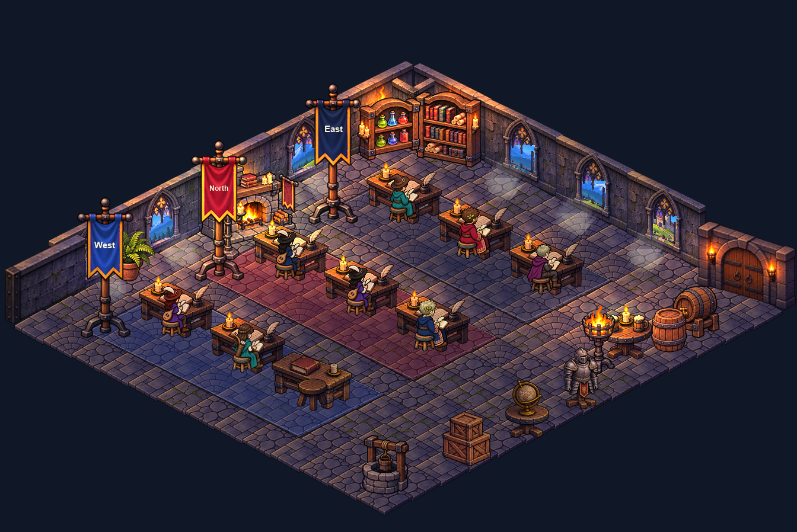

# Herdr-Hansol

Herdr-Hansol is a pixel-art layout for [Herdr App](https://herdr.dev) that shows the status of your coding agents at a glance. The default scene is **MOSSES**, a space console where each workspace is a planetary system, and you can switch to an **adventurers' guild hall** or an **office** scene. The interface is in Korean, with the Hansol logo and a dark theme.



This sample shows 8 demo agents in 3 workspaces (North, West, East). In the app, name tags and status marks are shown as well.

## Features

- Shows running agents, such as Claude Code and Codex, by workspace in MOSSES (default), the guild hall or the office.
- Switch the layout from the **설정** (Settings) menu in the header.
- Shows the working, awaiting approval, reported and idle counts in the header.
- Selecting an agent opens its terminal in a popup, with its workspace and status.
- **에이전트 상세** (Agent details) at the bottom shows the conversation and tool runs.
- Right-click a planet in MOSSES for its menu. **GIT** there opens the workspace's repository: commit graph, changed files, commit, push (with a confirm step), branch switch, GitHub PRs and CI runs (`gh`), GitLab merge requests, issues and pipelines (the token Git already stores), and dev tools (Explorer, VS Code, a terminal, npm scripts, `.env` keys, listening ports).
- A Codex conversation is linked only when the request and history on screen match exactly one session. Otherwise the terminal screen is shown.

## Installation

Herdr App and herdr-core must be installed. Python 3.10 or later with `numpy` and `Pillow` is also required.

Ask an agent in Herdr App:

```text
Read ~/.config/herdr-app/AGENTS.md, then add this layout: https://github.com/evelynn/Herdr-Hansol/tree/main/hansol
```

After installing, select the layout:

```powershell
python -m pip install numpy pillow
herdr-app check "$env:USERPROFILE\.config\herdr-app\mods\hansol"
herdr-app do layout.switch --name hansol
```

The first run generates the scene images, so the screen may take a while to appear.

## Configuration

To change workspaces, weather, colors and agent launch settings, create `config.json` in the installed mod folder, using `hansol/mods/hansol/config.example.json` as a reference. The defaults work without it.

```powershell
herdr-app do hansol.demo
```

This command turns the demo agents on or off. [hansol/RECIPE.md](hansol/RECIPE.md) describes the screen layout and behavior.

## License

[MIT License](LICENSE). The pixel art is under the same license.
