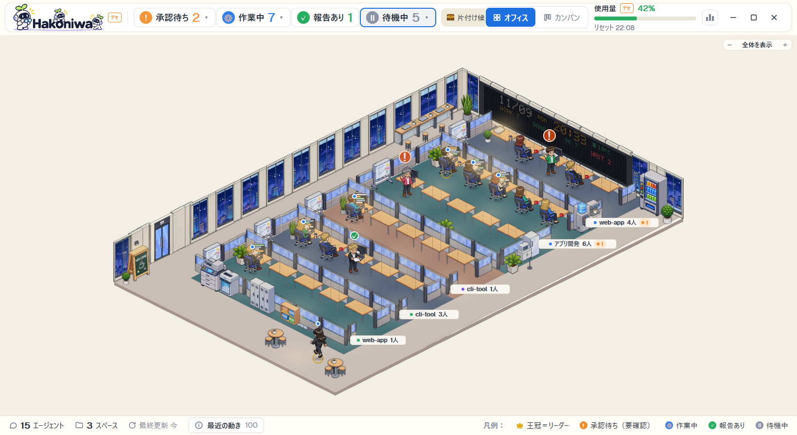

# Hakoniwa — a pixel-art office for your coding agents

A layout for [Herdr App](https://herdr.dev). Every coding agent on your PC (Claude Code, Codex, OpenCode, Cursor, Copilot,
Antigravity, in Herdr App, herdr TUI or T3 Code) works at a desk in a little isometric office. They walk in at the
entrance, type while they work, raise a hand when they wait for your approval, bring a paper when they have a report,
and leave when they are done. Click a person to read the conversation, approve, or type to them.

Made by [Trellis](https://trellis-grow.com/?utm_source=github.com&utm_medium=referral&utm_campaign=herdr-hakoniwa&utm_content=readme-top) in Fukuoka, Japan. Trellis builds websites and automates work with AI.



日本語は下にあります。

## What you see

- **Top band**: the Hakoniwa logo, the number of agents in each state (click one to pick the first of them), Claude Code
  usage, and the button that starts a new agent.
- **The office floor** (the whole window): one room per Herdr space (or per box: T3 Code, Herdr App, herdr TUI). Each agent
  is a person at a desk. Working: typing at the PC, a blue dot. Waiting for approval: standing, hand up, an orange `!`.
  Report ready: standing with a paper, a green `✓`. Idle: sitting with a red mug. A gold ring marks a leader (an agent with
  workers). The window outside follows the time of day and the weather; a board on the wall shows the weather and the counts.
- **Right panel** (opens when you click a person): the agent's head (name, state, what it is doing), its conversation or
  its terminal, approve / reject buttons while it waits, and a box to type to it.
- **Footer**: the number of people and spaces, the last update, and the legend.

The screen text is in **Japanese**.

## What you need

| | |
|---|---|
| Herdr App with herdr-core (`hc` on PATH) | the agents' states come from the App and `hc` |
| Python 3.10 or later on PATH | Windows: `pythonw`, `python` or `py`; elsewhere `python3` or `python` (or set `python` in `config.json`) |
| `numpy` and `Pillow` for that Python | `python -m pip install numpy pillow` (the office picture is made with them) |
| Windows | made and tested on Windows 11. macOS / Linux are not tested |
| Node.js | only for the Cursor / Copilot hooks (below) |

T3 Code and herdr TUI are optional: what is not on the PC is not shown.

## Add it

Ask your agent in Herdr App:

```
Read ~/.config/herdr-app/AGENTS.md, then add this layout: https://github.com/trellis-grow-org/herdr-hakoniwa/tree/main/hakoniwa
```

It copies `hakoniwa/layouts/hakoniwa.json` to `~/.config/herdr-app/layouts/` and `hakoniwa/mods/hakoniwa/` to
`~/.config/herdr-app/mods/`. Then:

```
python -m pip install numpy pillow
herdr-app check ~/.config/herdr-app/mods/hakoniwa
herdr-app do layout.switch --name hakoniwa
```

The first start cuts the art out of the sheets and builds the people: the floor says 準備中… (preparing) for a minute or two
while a background run finishes, then it appears. `ctrl-shift-l` switches back to your own layout.

**Cursor, Copilot and OpenCode** do not report their state to the App by themselves. To see them work, install the hooks
(they are new files, except Cursor's `hooks.json`, which is backed up first and only gets entries added):

```
python ~/.config/herdr-app/mods/hakoniwa/integrations/install-hooks.py --dry-run    # show what would change
python ~/.config/herdr-app/mods/hakoniwa/integrations/install-hooks.py              # install
python ~/.config/herdr-app/mods/hakoniwa/integrations/install-hooks.py --uninstall  # remove only what it added
```

## Settings

Nothing is needed. To change something, copy `mods/hakoniwa/config.example.json` to `mods/hakoniwa/config.json` and keep
only the keys you change. The main ones: `office.rooms` (rooms and their names), `office.sources` (which boxes to collect),
`office.weather` (`{"place": "Osaka"}`, `{"lat": 34.69, "lon": 135.50, "label": "OSAKA"}` or `{"enabled": false}`),
`office.colors`, and `office.launch` (how agents started from the office begin: by default each CLI as it starts by itself,
with no permission widened; e.g. `"codex": {"argv": ["codex", "-s", "workspace-write"]}`).

`herdr-app do hakoniwa.demo` switches a made-up cast on and off (for screenshots).

## What it does on your PC

Herdr asks you to know this before adding a mod. Hakoniwa does all three:

- **Network**: the collector asks Open-Meteo (`api.open-meteo.com`, and `geocoding-api.open-meteo.com` once if you give a
  place name) for the weather, at most every 30 minutes. No key, nothing about you is sent but the place. Turn it off with
  `"weather": {"enabled": false}`. The mod itself makes no network calls.
- **Programs it runs**:
  - `python` with its own scripts in `mods/hakoniwa/py/` (every few seconds: the collector; when the floor changes: the office
    picture) and `mods/hakoniwa/opencode-usage.py`.
  - `hc` (herdr-core): `ls`, `get`, `read` to show agents and their screens; `send` and `keys` only when you type to an agent
    or press approve / reject; `label` when you rename one.
  - `herdr` (the TUI) when herdr TUI agents are collected; the agent CLIs (`claude`, `codex`, `opencode`, `cursor-agent`,
    `agy`) when you start an agent, and their `--help` / `models` lists once a day for the new-agent window.
  - App commands: it focuses, opens, renames and closes spaces, tabs and terminals when you ask for it in the office. **By
    itself** it also keeps rooms with their people: it closes a space 6 s after the last agent it saw there is gone and no
    terminal is left in it, names a new space after its first agent, and moves a leader's workers into one space.
    `"office": {"auto_rooms": false}` turns all three off.
- **Files it reads outside its folder** (read only): `~/.claude.json` (Claude Code usage), `~/.claude/projects` and
  `~/.claude/sessions` (conversations), `~/.codex/sessions`, the OpenCode database (`~/.local/share/opencode/opencode.db`),
  `~/.t3/userdata/statev2.sqlite` (T3 Code), and herdr TUI through its CLI.
- **Files it writes**: `~/.config/herdr-app/hakoniwa-office/` (the pictures and its own logs; a few hundred MB),
  `%LOCALAPPDATA%/hakoniwa/` (`state.json`). A Claude started from the office gets a small `--settings` file from
  `hakoniwa-office/` that keeps its conversation (`office.launch.claude_settings` in `config.json` turns it off).

## Remove it

Delete `layouts/hakoniwa.json`, `mods/hakoniwa/`, `hakoniwa-office/` (all under `~/.config/herdr-app`) and
`%LOCALAPPDATA%/hakoniwa/`. Run `install-hooks.py --uninstall` first if you installed the hooks.

## About Trellis

Hakoniwa is made and shared by [Trellis](https://trellis-grow.com/?utm_source=github.com&utm_medium=referral&utm_campaign=herdr-hakoniwa&utm_content=readme-about) in Fukuoka, Japan. Trellis builds websites and automates work with AI agents.
How Hakoniwa was built is on our [tech notes](https://trellis-grow.com/tech/?utm_source=github.com&utm_medium=referral&utm_campaign=herdr-hakoniwa&utm_content=readme-technotes) (in Japanese).

## License

MIT (see `LICENSE`).

The pixel-art furniture, rooms and people (`mods/hakoniwa/py/sheets/`) were made with an image generation model (OpenAI gpt-image-2) and then cut into parts by the scripts here. They are covered by the same license.

---

# Hakoniwa — コーディングエージェントのドット絵オフィス

[Herdr App](https://herdr.dev) のレイアウトです。PC で動くコーディングエージェント（Claude Code・Codex・OpenCode・Cursor・
Copilot・Antigravity。Herdr App・herdr TUI・T3 Code の中のもの）が、小さなオフィスの机で働きます。入口から入ってきて、作業中は
PC を打ち、承認を待つと手を挙げ、報告があると書類を持って立ち、終わると出ていきます。人を押すと、会話を読む・承認する・
打ち込むことができます。

作ったのは、福岡でホームページの制作と AI による業務の自動化をしている [Trellis](https://trellis-grow.com/?utm_source=github.com&utm_medium=referral&utm_campaign=herdr-hakoniwa&utm_content=readme-top-ja) です。

## 見えるもの

- **上の帯**: ロゴ、状態ごとの人数（押すとその状態の先頭の人を選ぶ）、Claude Code の使用量、新しいエージェントを立てるボタン。
- **オフィスの床**（窓いっぱい）: Herdr のスペースごと（または箱ごと: T3 Code・Herdr App・herdr TUI）に部屋が1つ。作業中は PC を
  打ち青い丸、承認待ちは立って手を挙げ橙の「!」、報告ありは書類を持ち緑の「✓」、待機は赤いマグを持って座る。足元の金の輪は
  リーダー（子のワーカーがいる人）。窓の外は時刻と天気で変わり、壁の掲示板に天気と人数が出る。
- **右のパネル**（人を押すと開く）: その人の見出し（名前・状態・していること）、会話か端末、承認待ちのときの承認・却下のボタン、
  打ち込む欄。
- **フッター**: 人数・スペース数・最終更新と凡例。

画面の言葉は日本語です。

## 要るもの

- Herdr App と herdr-core（`hc` が PATH にあること）
- PATH にある Python 3.10 以上（Windows は `pythonw`・`python`・`py`、ほかは `python3`・`python` の順に探す。`config.json` の
  `python` で指定もできる）と、その Python の `numpy`・`Pillow`（`python -m pip install numpy pillow`）
- Windows（Windows 11 で作り、確かめた。macOS・Linux は未確認）
- Node.js（Cursor・Copilot のフックを使うときだけ）

T3 Code と herdr TUI は無くてもよい（無いものは出ない）。

## 入れ方

Herdr App のエージェントに頼む:

```
Read ~/.config/herdr-app/AGENTS.md, then add this layout: https://github.com/trellis-grow-org/herdr-hakoniwa/tree/main/hakoniwa
```

`hakoniwa/layouts/hakoniwa.json` が `~/.config/herdr-app/layouts/` に、`hakoniwa/mods/hakoniwa/` が `~/.config/herdr-app/mods/`
に写される。そのあと:

```
python -m pip install numpy pillow
herdr-app check ~/.config/herdr-app/mods/hakoniwa
herdr-app do layout.switch --name hakoniwa
```

初回は素材シートから絵を切り出して人を作るため、床は 1〜2 分「準備中…」になり、裏の処理が終わると出る。自分のレイアウトへは
`ctrl-shift-l` で戻る。

**Cursor・Copilot・OpenCode** は自分では App に状態を送らない。働く様子を出すには、フックを入れる（新しいファイルを置く。
Cursor の `hooks.json` だけは先に控えを作り、項目を足すだけ）:

```
python ~/.config/herdr-app/mods/hakoniwa/integrations/install-hooks.py --dry-run    # 変わる所だけ見る
python ~/.config/herdr-app/mods/hakoniwa/integrations/install-hooks.py              # 入れる
python ~/.config/herdr-app/mods/hakoniwa/integrations/install-hooks.py --uninstall  # 自分が足したものだけ外す
```

## 設定

無くても動く。変えるときは `mods/hakoniwa/config.example.json` を同じ場所の `config.json` に写し、変えるキーだけ残す。主なもの:
`office.rooms`（部屋と名前）、`office.sources`（どの箱を集めるか）、`office.weather`（`{"place": "Osaka"}`・
`{"lat": 34.69, "lon": 135.50, "label": "OSAKA"}`・`{"enabled": false}`）、`office.colors`、`office.launch`（オフィスから立てる
エージェントの起動の言葉。既定は各 CLI の素の起動で、権限は広げない。例 `"codex": {"argv": ["codex", "-s", "workspace-write"]}`）。

`herdr-app do hakoniwa.demo` で見本の人たち（撮影用）の入／切。

## この PC でしていること

Herdr は、mod を入れる前に次の3つを知らせるよう求めている。Hakoniwa は3つともする。

- **ネットに出る**: collector が天気を Open-Meteo（`api.open-meteo.com`。地名を書いたときは最初の1回だけ
  `geocoding-api.open-meteo.com`）に、多くて30分に1回問い合わせる。キーは要らず、送るのは場所だけ。
  `"weather": {"enabled": false}` で止まる。mod 自身はネットに出ない。
- **プログラムを動かす**:
  - `python` で `mods/hakoniwa/py/` の自分のスクリプト（数秒ごとに collector、床が変わるとオフィスの絵）と
    `mods/hakoniwa/opencode-usage.py`。
  - `hc`（herdr-core）: 人と画面を出すための `ls`・`get`・`read`。`send`・`keys` は人が打ち込んだときと承認・却下を押したときだけ。
    名前を変えたときは `label`。
  - herdr TUI を集めるときは `herdr`。エージェントを立てたときはその CLI（`claude`・`codex`・`opencode`・`cursor-agent`・`agy`）、
    新しいエージェントの窓のために1日1回その `--help`・`models` の一覧。
  - App のコマンド: スペース・タブ・端末を選ぶ・開く・名前を変える・閉じるのは、人がオフィスで頼んだとき。**自分からも**、部屋を
    人と一緒に保つ: 見ていたエージェントが全員いなくなり端末も残っていないスペースを 6 秒後に閉じる、新しいスペースに最初の
    エージェントの名前を付ける、リーダーのワーカーを1つのスペースに集める。`"office": {"auto_rooms": false}` で3つとも止まる。
- **自分のフォルダの外を読む**（読むだけ）: `~/.claude.json`（Claude Code の使用量）、`~/.claude/projects`・`~/.claude/sessions`
  （会話）、`~/.codex/sessions`、OpenCode のデータベース（`~/.local/share/opencode/opencode.db`）、`~/.t3/userdata/statev2.sqlite`
  （T3 Code）、herdr TUI は CLI 経由。
- **書くファイル**: `~/.config/herdr-app/hakoniwa-office/`（絵と自分の記録。数百 MB）、`%LOCALAPPDATA%/hakoniwa/`（`state.json`）。
  オフィスから立てた Claude には、会話を残すための小さな `--settings` のファイルを `hakoniwa-office/` から渡す
  （`config.json` の `office.launch.claude_settings` で切れる）。

## 外し方

`~/.config/herdr-app` の `layouts/hakoniwa.json`・`mods/hakoniwa/`・`hakoniwa-office/` と、`%LOCALAPPDATA%/hakoniwa/` を消す。
フックを入れたときは、先に `install-hooks.py --uninstall` を流す。

## Trellis について

Hakoniwa は、福岡でホームページの制作と、AI による業務の自動化をしている [Trellis](https://trellis-grow.com/?utm_source=github.com&utm_medium=referral&utm_campaign=herdr-hakoniwa&utm_content=readme-about-ja) が作って配っています。
作り方は [Trellis の技術ノート](https://trellis-grow.com/tech/?utm_source=github.com&utm_medium=referral&utm_campaign=herdr-hakoniwa&utm_content=readme-technotes-ja) に書いています。

## ライセンス

MIT（`LICENSE`）。

家具・部屋・人のドット絵（`mods/hakoniwa/py/sheets/`）は、画像生成のモデル（OpenAI の gpt-image-2）で作り、ここにあるスクリプトで部品に切り出したものです。同じライセンスで配ります。
