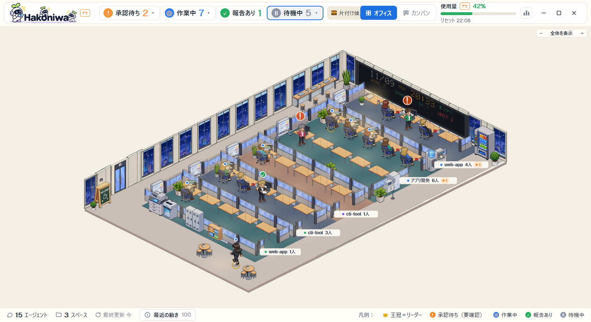

# Hakoniwa

A pixel-art office that fills the Herdr App window. Every coding agent on the PC is a person at a desk in a 2:1 isometric
office: they walk in at the entrance, type while working, stand with a hand up when they wait for approval, bring a paper
when they have a report, sit with a red mug when idle, and leave when they are gone. A band on top counts them by state; a
click on a person opens a column on the right with their conversation (or terminal), approve / reject buttons and a box to
type to them. The screen text is Japanese.

## What you see

Top to bottom (layout `hakoniwa`, theme `paper`, UI font Geist 13, window background `#f3efe7`, no title bar):

- **Band**, 72 px, white `#ffffff` card with rounded corners (14), padding 16. Left: the logo `icons/hakoniwa-logo.png` (480×144,
  drawn 187×56: the word "Hakoniwa" with a leader and two workers; below 1250 px window width only the leader's head
  `icons/hakoniwa-head.png`, 44 px). Then one chip per state with its count, coloured by state (working `#2F80ED`, blocked
  `#F28C28`, done `#27AE60`, idle `#8A94A6`), Claude Code usage (percent of the current session, grey when the value is
  older than 15 min), and the "エージェント" button that opens the new-agent window. Text ink `#1F2A37`, muted `#7b8494`.
- **Office floor**, the rest of the window. A pixel-art floor drawn from PNG pieces: an entrance door with a welcome board
  and a plant at the lower left, the drinks (vending machine, coffee, water, microwave, fridge) beside the LED board, office
  machines and shelves along the partitions (copier, shredder, lockers, bookshelf, whiteboard, sorted bins), round tables
  on the free floor, then one glass-walled room per Herdr space, stacked in one column towards the lower left, with one desk
  per agent plus one spare and a plant at its back corner. The floor's size follows the rooms and the people. Each room has
  a name plate at its front corner. Windows show the outside: morning, day, evening or night pictures by the clock, with
  clouds, rain, snow, fog or thunder from the weather; a moon (its phase from the date) and stars at night; now and then a
  flock of birds flies past (not in rain, snow or thunder). An LED board on a wall shows the date, time, place,
  temperature and counts. On the floor's left edge a folding list of spaces and their agents and terminals (a crown on
  leaders), with 「新しいエージェント」 and 「スペースを作る」 at the bottom.
- **Right column**, 480 px, background `#fbf8f1`, hidden until a person is clicked: a 200 px head (name, state chip, model,
  what the agent is doing, buttons), then one of three views stacked in the same place: the agent's terminal, its
  conversation (bubbles: the person's in `#d6e6fb`, the agent's in `#e8f0fe`, tool lines in `#f6f7f9`), or the team tree.
  While the agent waits, an orange card (`#fff1df`, border `#f2c58a`) shows what it asks and the approve / reject buttons;
  under it a box to type to the agent.
- **Footer**, 40 px: people and spaces counted, the last update, and the legend of the four states.

## How it behaves

- **working**: sits at the desk typing (two typing frames), the monitor shows scrolling code, a blue dot over the head. The
  longer the run, the more cans and cups on the desk; the more memory, the taller the paper pile.
- **blocked** (approval or a question): stands up at the own desk facing us with an empty hand raised, a bouncing orange
  `!`. The right column shows the request; 承認 / 却下 press the choice the agent's screen offers
  (read from the terminal text with `hc read`, never a fixed number) and the column says whether the state changed.
- **done** (a report): stands at the own desk holding a paper with a green `✓`; sits down again once the report is seen.
- **idle**: sits at the own desk with a red mug (the mug is only for idle). Idle for 60 min or more is a look, not a state:
  the bubble fades. Now and then an idle person walks to the nearest water server or coffee machine (sometimes the vending
  machine) and comes back with a cup; at most 1-2 people are on a break at once.
- **Walking**: there is no approval desk, counter or lounge. People walk only to come in and leave, to meet another agent
  (below) and for that short break.
- **New and gone**: a new agent walks in through the entrance door (it opens and closes) to its desk; a gone one walks out.
- **Leaders**: an agent with workers wears a black jacket and has a gold ring at the feet (a crown in the left tree). When
  agents message each other they leave their seats for a few seconds and meet with a "…" bubble.
- **Clicks**: a person, a chip in the band or a row in the lists picks that agent and opens the right column; the band's
  state chips pick the first agent in that state; a room's name plate opens the list of its people (click one to pick it);
  the floor has zoom controls and can be dragged. **Hover** shows tooltips on buttons and people. **Keys**: Esc closes the
  chat slide, the inbox and the new-agent window.
- **Rooms live with their people** (`office.auto_rooms`, on by default): a space whose last agent is gone and that has no
  terminal left is closed after 6 s, a new space is named after its first agent, and a leader's workers are gathered in one
  space.
- The collector runs every 4 s; Herdr App agents' status comes live from `agents()`, so they change at once.

## Built from

- **Layout** `layouts/hakoniwa.json`: `column` root (`titlebar: none`, `theme: paper`, colors background `#ffffff`,
  foreground `#303746`, border `#e5e7ec`, accent `#7465db`, `terminal_padding [12, 10]`, gap 0, not resizable):
  - `hud-band` block 72 px, `window_drag: true`: mod `hakoniwa`, props `{role: "band", buttons: true, switch: true}`.
  - `main-row` row (weight 1): `office` block (weight 1, `{role: "office"}`) and `right` column 480 px, `hidden: true`:
    `r-head` block 200 px (`{role: "rhead"}`), `r-body` stack of `r-term` (`{agent: "focused"}`), `r-chat`
    (`{role: "rchat"}`), `r-tree` (`{role: "rtree"}`).
  - `hud-footer` block 40 px (`{role: "footer"}`).
- **Mod** `mods/hakoniwa/` (`mod.json` `{"place": "none"}`): `main.js` (one class for every role) and its modules: `office.js`
  (the floor: draws the planned scene, people, animation with `.frames()` / `.loop()` / `.transition()`), `life.js` (states,
  trips), `meet.js`, `board.js` (the LED board), `chat.js` / `detail.js` / `approve.js` / `approve-view.js` / `tool-lines.js`
  (conversation and approval), `panel.js` / `region.js` / `room.js` / `inbox.js` / `feed.js` / `launch.js` / `grid.js`,
  `actions.js` (the app commands as plans: `tab.new`, `space.new`, `space.close`, `space.rename`, `space.select`,
  `tab.rename`, `terminal.park`, `terminal.keep`, `terminal.kill`, `agent.focus`, `layout.hide`, `layout.resize`),
  `common.js` / `ui.js` / `ui-rules.js` / `icons.js` (`icons/*.svg`, the logo PNGs), `config-defaults.js`.
  Windows it opens with `openOverlay`: the chat window (`key: "hakoniwa-chat"`), the inbox (`"hakoniwa-inbox"`), a terminal
  window (`"hakoniwa-term"`), dialogs `launch`, `confirm`, `room-new`, `tui-prompt`.
- **herdr functions**: `agents()`, `spaces()`, `panes()`, `focused()`, `settings()`, `run()`, `exec()`, `hc()` (`ls --json`,
  `get --json`, `read`, `send`, `keys`, `label`), `readTextFile`, `writeTextFile`, `watchFolder`, `shared` / `setShared`
  (keys `hakoniwa.*`: `view`, `demo`, `sel`, `pick`, ...), `nextCommand` (commands `hakoniwa.view`, `hakoniwa.demo`,
  `hakoniwa.chat-next`, ...), `openOverlay` / `closeOverlay`, `pickFolder`, `appHome()`, `home()`.
- **Programs**: Python 3.10+ runs `py/hakoniwa-collector.py` (stdlib only: herdr-core's named pipe and `hc`, the `herdr`
  CLI for herdr TUI, T3 Code's SQLite read-only, Claude Code / Codex transcripts, `~/.claude.json` usage, Open-Meteo weather
  every 30 min) which writes `state.json`; `py/hakoniwa-office.py` with `py/hakoniwa_sprites.py` (numpy, Pillow) plans the
  floor for the agents and the window size and writes the scene (JSON) and its pictures under
  `<herdr-app>/hakoniwa-office/`; `py/hakoniwa_models.py` lists each agent CLI's models for the new-agent window;
  `opencode-usage.py` reads OpenCode's token use. Agent CLIs start with `office.launch.kinds` (default: `claude`, `codex`,
  `opencode`, `cursor-agent`, `agy` with no extra words).
- **Art**: 33 generated pixel-art sheets plus six folders of 2:1 isometric pieces in `py/sheets/` (room parts, desks,
  people in poses and 8-frame walks, windows, outside views, weather, moon, equipment, plants). The sprites code cuts the
  pieces by their alpha, recolours people from the agent id (jacket, hair, skin) and keeps them in `hakoniwa-office/sheet/`.

## Watch out

- **The App stops a program after 30 s.** The first floor needs the pieces cut and the people made (over 30 s), so
  `hakoniwa-office.py` starts a detached warm run (`--warm-last`, one at a time by `warm.lock`) and the floor says 準備中…
  until it is done (about 1–2 minutes). Only one plan runs at a time (`hakoniwa.planflight`); a stuck plan keeps the last
  floor.
- **Nothing Python writes may land in `mods/hakoniwa/`**: a file saved there reloads the mod. The scripts set
  `sys.dont_write_bytecode` (no `__pycache__`), and every output goes to `<herdr-app>/hakoniwa-office/` or
  `%LOCALAPPDATA%/hakoniwa/`.
- **No config.json**: the mod finds Python itself (`pythonw`, `python`, `py` on Windows; `python3`, `python` elsewhere) by
  running `hakoniwa-collector.py --where`, which also says where `state.json` is and whether numpy / Pillow are there; the
  band says what is missing.
- **The name is in many places**: renaming the mod means its folder, the `mod` names in the layout, `MOD_DIR` in
  `config-defaults.js`, the `mods/hakoniwa/` paths in `feed.js` and `icons.js`, the `hakoniwa.*` commands and shared keys,
  and the Python folders `hakoniwa-office` and `%LOCALAPPDATA%/hakoniwa`.
- **Windows first**: the collector reads the process table with Toolhelp (no WMI) and uses `pythonw` to avoid console
  windows. macOS / Linux are not tested.
- **Cursor, Copilot and OpenCode** report no state by themselves: without `integrations/install-hooks.py` they stay idle.
- **Memory**: the App grows with the pictures; over about 1.2 GB the band suggests restarting it. The demo was tried up to
  40 people in 8 spaces.
- **Approval keys** are chosen from the agent's screen text; if the screen changed in between, nothing is sent and the
  column says so. Keys are sent only when the person presses.
- `office.auto_rooms` closes spaces by itself (see How it behaves); a fresh build that skips it leaves empty rooms in the
  left list.

## Done when

- `herdr-app check ~/.config/herdr-app/mods/hakoniwa` passes.
- `python ~/.config/herdr-app/mods/hakoniwa/py/hakoniwa-collector.py --where` prints JSON with `"numpy": true` and
  `"pillow": true`.
- After `herdr-app do layout.switch --name hakoniwa`, the band shows the counts of `hc ls` agents by state and the floor
  appears within about two minutes, with one room per space that has an agent.
- `herdr-app do hakoniwa.demo` shows the made-up cast in all four states (working, blocked with `!`, done with `✓`, idle
  with a red mug) and a leader with a gold ring; the same command turns it off.
- Clicking a person opens the 480 px right column with that agent's conversation; a blocked agent shows the orange card with
  承認 / 却下, and pressing one changes the agent's state.
- Starting an agent with the band's エージェント button opens a tab in the chosen space running that CLI, and the person
  walks in at the entrance.

---

Made by [Trellis](https://trellis-grow.com/?utm_source=github.com&utm_medium=referral&utm_campaign=herdr-hakoniwa&utm_content=recipe), Fukuoka, Japan.
